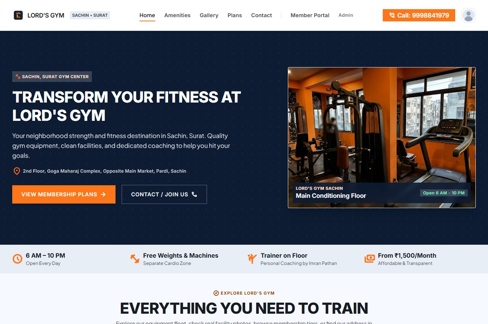
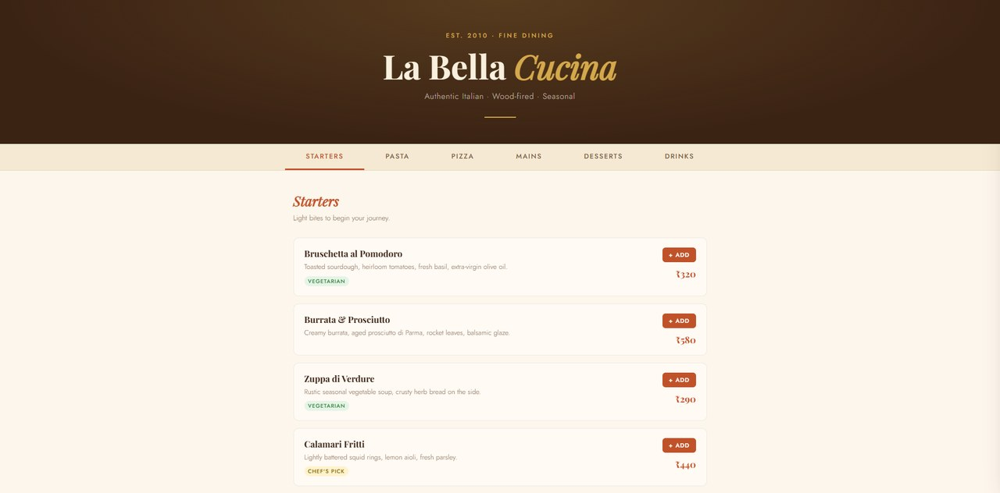
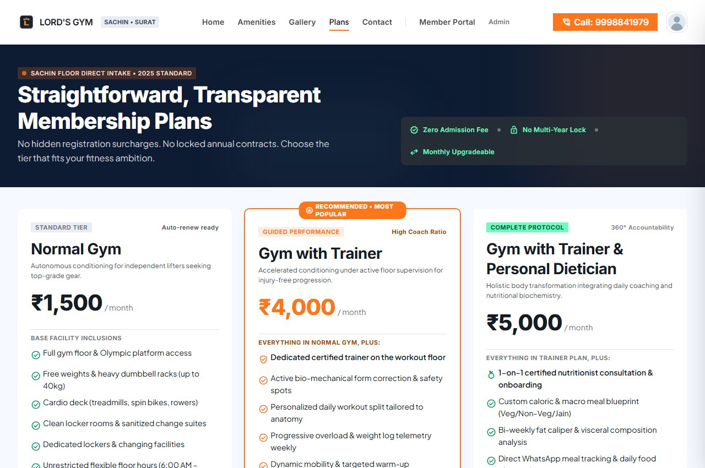
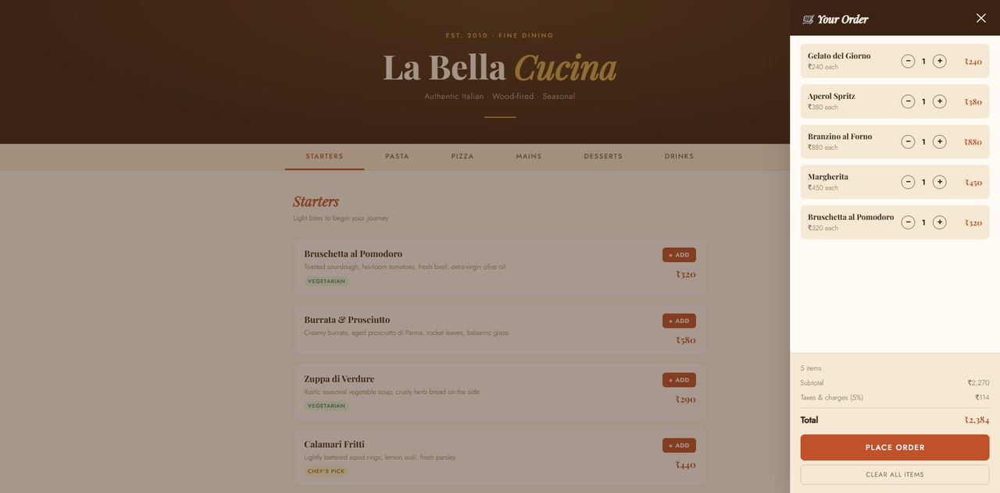
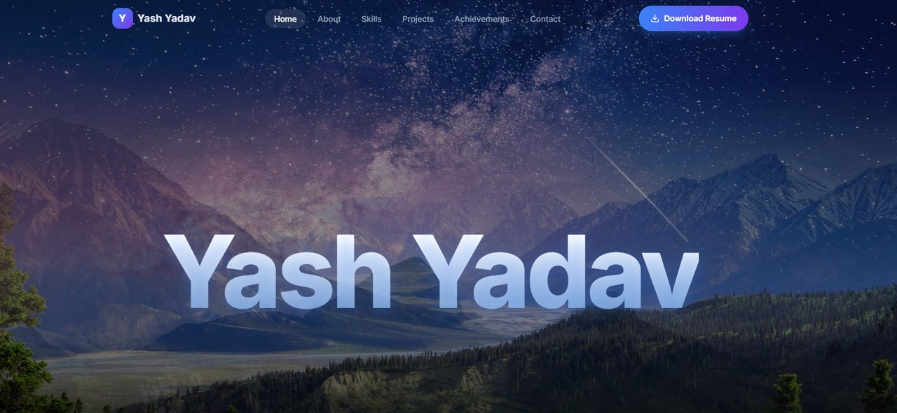

# Yash Yadav | Personal Portfolio Website

A responsive, dark-themed single-page portfolio built with **React, Vite, TypeScript and Tailwind CSS**, featuring a GSAP + Lenis parallax intro. Created as the mini project for **IT4048 – Version Control with Git and GitHub**.

[](https://yadavyashj.github.io/YashYadav_PortfolioWebsite/)
[](https://github.com/YadavYashJ/YashYadav_PortfolioWebsite)

- **Repository:** https://github.com/YadavYashJ/YashYadav_PortfolioWebsite
- **Live site:** https://yadavyashj.github.io/YashYadav_PortfolioWebsite/

---

## Objective

To present my introduction, education, skills, projects, achievements, résumé and contact details in one polished website, while practising the complete Git and GitHub workflow: `init`, `add`, `commit`, `push` and deployment with GitHub Pages.

## Features

- Sticky, blurred navbar with active-section highlighting, mobile hamburger menu and keyboard support
- Parallax intro banner (21st.dev / Osmo component) that is disabled for users who prefer reduced motion
- Sections: Hero, About, Skills, Projects, Achievements timeline, Résumé and Contact
- Project cards with a screenshot gallery, GitHub repository links and live previews
- Contact form with validation and a `mailto:` fallback (optional Formspree support)
- Résumé view and download buttons that activate only when `public/resume.pdf` exists
- All content editable from a single file: `src/data/portfolioData.ts`
- Accessibility: labelled form fields, visible focus states, skip link, reduced-motion support and 44px touch targets

## Projects Showcased

| Project | Stack | Links |
| --- | --- | --- |
| **Lord's Gym** – gym website with member portal and admin dashboard | React, Tailwind CSS, PHP, MySQL | [GitHub Repository](https://github.com/YadavYashJ/lords-gym-website) |
| **La Bella Cucina** – restaurant menu with a live order cart | HTML, CSS, JavaScript | [Live Preview](https://yadavyashj.github.io/YashYadav_PortfolioWebsite/projects/la-bella-cucina/index.html) |
| **Personal Portfolio Website** – this project | React, TypeScript, Tailwind CSS | [GitHub Repository](https://github.com/YadavYashJ/YashYadav_PortfolioWebsite) |

## Tech Stack

| Category | Tools |
| --- | --- |
| Framework | React 18, Vite 5, TypeScript |
| Styling | Tailwind CSS 3 |
| Animation | Motion (`motion/react`), GSAP + ScrollTrigger, Lenis |
| Icons | Lucide React |
| Deployment | GitHub Pages via `gh-pages` |

## Getting Started

**Prerequisites:** Node.js 18 or later and Git.

```bash
# 1. Clone the repository
git clone https://github.com/YadavYashJ/YashYadav_PortfolioWebsite.git
cd YashYadav_PortfolioWebsite

# 2. Install dependencies
npm install

# 3. Start the dev server (http://localhost:5173)
npm run dev
```

Other scripts:

```bash
npm run build      # production build into dist/
npm run preview    # preview the production build locally
npm run deploy     # build and publish to GitHub Pages
```

## Customisation

- **Content:** edit `src/data/portfolioData.ts` (profile, about, skills, projects, timeline and navigation).
- **Photo and screenshots:** `public/profile.jpg` and `public/projects/`.
- **Résumé:** `public/resume.pdf`.
- **Repository name for deployment:** `REPO_NAME` in `vite.config.ts` (set to `YashYadav_PortfolioWebsite`).
- **Contact form:** by default it opens the visitor's email app. To receive messages directly, paste a Formspree endpoint into `formEndpoint` in `portfolioData.ts`.

## Project Structure

```text
YashYadav_PortfolioWebsite/
├── public/
│   ├── projects/            project screenshots and La Bella Cucina live demo
│   ├── favicon.svg
│   ├── profile.jpg
│   └── resume.pdf
├── src/
│   ├── components/          Navbar, Hero, About, Skills, Projects,
│   │   │                    Achievements, Resume, Contact, Footer, Reveal,
│   │   │                    SectionHeading, BrandIcons, icons
│   │   └── ui/              parallax-scrolling.tsx, parallax-demo.tsx,
│   │                        gradient-button.tsx
│   ├── data/portfolioData.ts   all editable content
│   ├── hooks/               useActiveSection, useResume
│   ├── lib/                 utils.ts, scroll.ts
│   ├── App.tsx
│   ├── main.tsx
│   ├── index.css
│   └── vite-env.d.ts
├── CHECKLIST.md
├── REPORT_OUTLINE.md
├── components.json
├── index.html
├── package.json
├── postcss.config.js
├── tailwind.config.js
├── tsconfig.json
├── vite.config.ts
└── README.md
```

## Git and GitHub Workflow

```bash
git init
git add .
git commit -m "Initial commit: portfolio website"
git branch -M main
git remote add origin https://github.com/YadavYashJ/YashYadav_PortfolioWebsite.git
git push -u origin main
```

Further changes were made as small, descriptive commits so the full history is visible in the repository.

## Deployment (GitHub Pages)

```bash
npm run deploy
```

This builds the site and publishes `dist/` to the `gh-pages` branch. Then on GitHub:

1. Go to **Settings → Pages**
2. Set **Source** to *Deploy from a branch*, branch `gh-pages`, folder `/ (root)`
3. Click **Save**. The site is then live at https://yadavyashj.github.io/YashYadav_PortfolioWebsite/

> **Blank page?** The usual cause is `REPO_NAME` in `vite.config.ts` not matching the repository name exactly.

## Screenshots

| Lord's Gym | La Bella Cucina |
| --- | --- |
|  |  |
|  |  |



## Credits

- Parallax component by [Osmo](https://www.osmo.supply/) via [21st.dev](https://21st.dev)
- Parallax photos by Unsplash contributors

## Author

**Yash Yadav** – [GitHub](https://github.com/YadavYashJ) · [LinkedIn](https://www.linkedin.com/in/yash-yadav-109864371)
